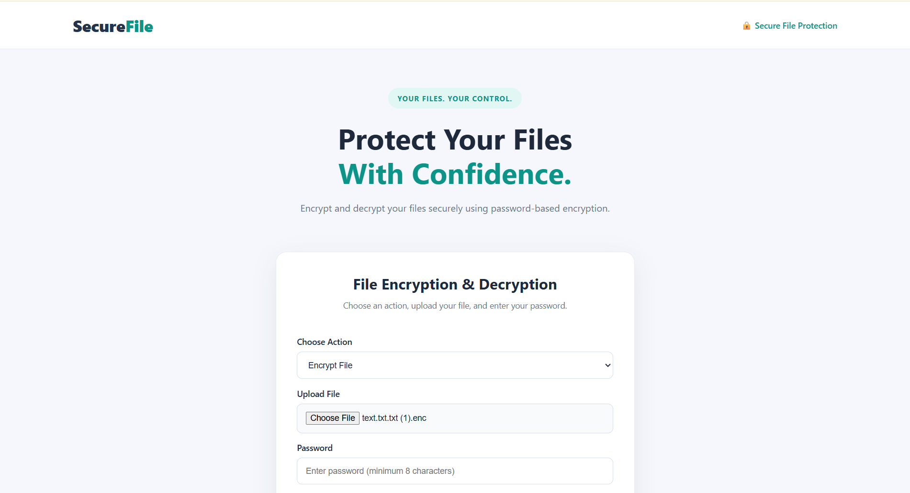

    # SecureFile — File Encryption & Decryption Tool

SecureFile is a web-based application that allows users to encrypt and decrypt files using password-based encryption. It provides a simple and user-friendly interface to help protect files from unauthorized access.

## Features

- Encrypt files using a password.
- Decrypt encrypted files using the correct password.
- Password-based key derivation using PBKDF2HMAC.
- Secure file encryption using Fernet.
- Download encrypted and decrypted files.
- Simple and responsive user interface.
- Supports file uploads up to 16 MB.
- Files are not permanently stored by the application.

## Technologies Used

- Python
- Flask
- Cryptography
- HTML5
- CSS3
- JavaScript
- Waitress
- GitHub
- Render

## Live Demo

https://securefile-encryption-tool.onrender.com

## Screenshot



## GitHub Repository

https://github.com/Vaishnavi76685/SecureFile-Encryption-Tool

## Installation & Setup

### 1. Clone the repository

```bash
git clone https://github.com/Vaishnavi76685/SecureFile-Encryption-Tool.git
```

### 2. Navigate to the project folder

```bash
cd SecureFile-Encryption-Tool
```

### 3. Create a virtual environment

```bash
python -m venv .venv
```

### 4. Activate the virtual environment

For Windows:

```bash
.venv\Scripts\activate
```

### 5. Install dependencies

```bash
pip install -r requirements.txt
```

### 6. Run the application

```bash
python app.py
```

Open the following URL in your browser:

http://127.0.0.1:5000

## How to Use

### Encrypt a File

1. Open SecureFile.
2. Select **Encrypt File**.
3. Upload the file you want to encrypt.
4. Enter a password of at least 8 characters.
5. Click **Process File**.
6. Download the encrypted file.

### Decrypt a File

1. Select **Decrypt File**.
2. Upload the encrypted `.enc` file.
3. Enter the same password used during encryption.
4. Click **Process File**.
5. Download the decrypted file.

## Security Notes

- Use a strong and unique password.
- Keep your password safe. The application cannot recover your file if you forget the password.
- Decryption requires the correct password.
- Do not upload sensitive files to a public demo unless you understand the risks of using a hosted service.
- The application uses Fernet authenticated encryption and PBKDF2HMAC for password-based key derivation.

## Project Structure

```text
SecureFile-Encryption-Tool/
├── static/
│   ├── script.js
│   └── style.css
├── templates/
│   └── index.html
├── app.py
├── requirements.txt
├── .gitignore
└── README.md
```

## Author

Developed as a cybersecurity project to demonstrate file encryption and decryption using Python and Flask.

## License

This project is available for educational and learning purposes.